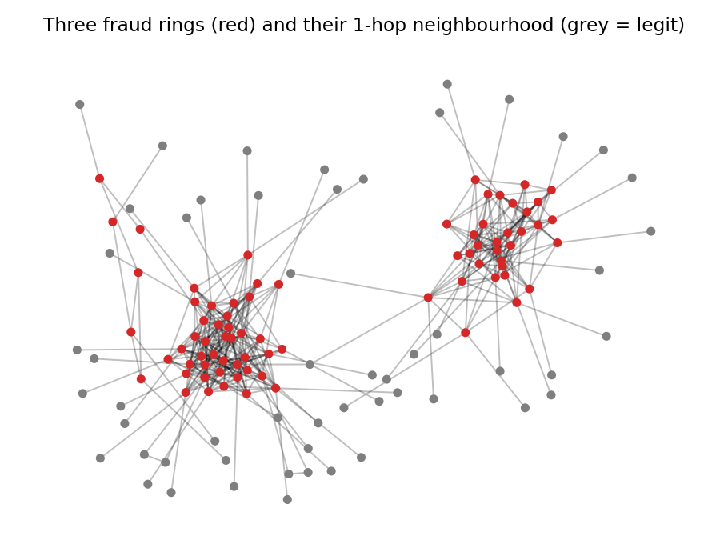
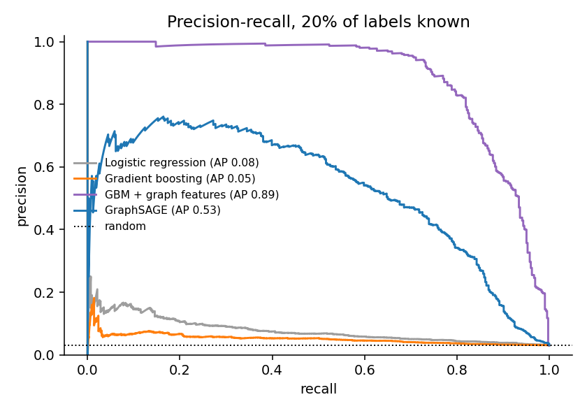
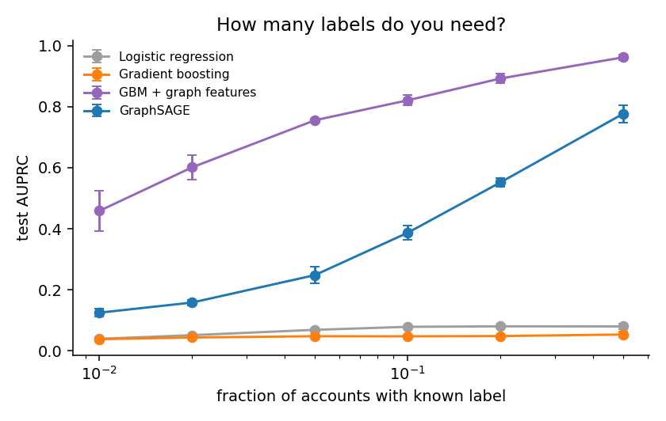
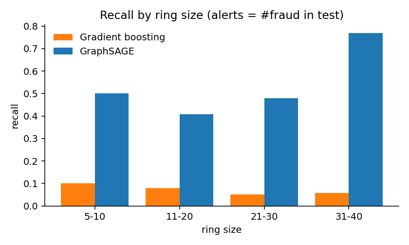
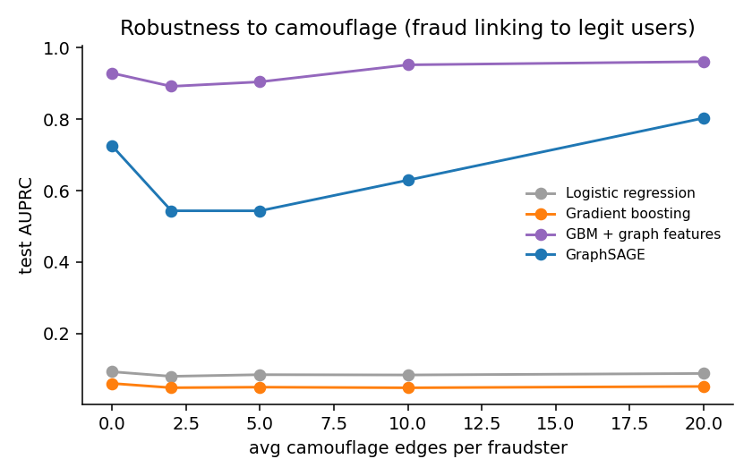

# fraud-rings

**A synthetic benchmark for coordinated fraud rings, and an honest look at when graph signal beats per-account features, and when a GNN is not the best way to use it.**



Fraud in the real world is often *organised*: groups of accounts reuse the same devices, payment instruments or addresses. Individually each account looks almost normal; together they form a dense cluster. Real abuse datasets can't be shared, so this repo provides a fully synthetic generator (`fraud_graph.py`) with the properties that make the problem hard:

- **Rare positives:** 3% of 20,000 accounts are fraudulent, organised in 30 rings of 5-40 accounts.
- **Weak features:** per-account features shift by only 0.45σ on 4 of 12 dimensions.
- **Benign dense groups:** 3,000 households (2-4 accounts) and 150 shared-IP hubs (10-60 accounts) that also mix in some fraudsters.
- **Camouflage:** each fraudster links to Poisson(2) random legitimate accounts.

The result is 23,321 undirected edges, with edge homophily 0.93. 27% of fraudster edges point to legitimate accounts.

## Models compared

| Model | Input |
|---|---|
| Logistic regression | per-account features |
| Gradient boosting (sklearn HistGBM) | per-account features |
| **GBM + graph features** | features + 1- and 2-hop neighbour means, log-degree, and the count and fraction of *training-labelled* fraud neighbours (no test-label leakage) |
| GraphSAGE (2 layers, from scratch) | features + edges, class-weighted BCE, early stopping on validation AUPRC |

## Results (20% of labels known, 5 seeds)



| Model | AUPRC | ROC-AUC | Recall @ 90% precision |
|---|---|---|---|
| Logistic regression | 0.081 ± 0.003 | 0.704 | 0.00 |
| Gradient boosting | 0.048 ± 0.002 | 0.612 | 0.00 |
| GraphSAGE | 0.554 ± 0.023 | 0.943 | 0.00 |
| **GBM + graph features** | **0.897 ± 0.016** | **0.989** | **0.77** |

The random-classifier AUPRC is 0.030.

**Takeaways**

1. **Per-account features are close to useless here** (AUPRC 0.05-0.08), by construction. The signal lives in the structure.
2. **The best model is not the GNN.** A boosted tree fed with *label-aware* neighbour features (how many of my neighbours are known fraud?) beats GraphSAGE by 0.34 AUPRC. GraphSAGE only sees neighbours' *features*, not their *labels*. This matches results on real benchmarks where label propagation and "C&S"-style tricks rival deep GNNs (Huang et al., 2021).
3. **Plain GBM does worse than logistic regression.** With weak, linear signal and `class_weight="balanced"`, the trees overfit noise. A useful reminder to always keep a linear baseline.

### Label scarcity


| Labelled fraction | LogReg | GBM | GBM + graph | GraphSAGE |
|---|---|---|---|---|
| 1% | 0.039 | 0.038 | **0.459** | 0.125 |
| 5% | 0.069 | 0.048 | **0.755** | 0.248 |
| 20% | 0.080 | 0.049 | **0.892** | 0.552 |
| 50% | 0.080 | 0.054 | **0.962** | 0.777 |

The label-aware approach degrades gracefully. Even with 1% labels (about 6 known fraudsters), it finds a large share of each ring.

### Recall by ring size (alert budget = number of fraudsters in test)


GraphSAGE recall rises from 0.41-0.50 on rings of 5-30 to 0.77 on rings of 31-40. Bigger rings give more neighbours to aggregate over. Tabular GBM stays at 5-10% for every size.

### Camouflage: a lesson about threat models


| Camouflage edges / fraudster | Edge homophily | GBM + graph | GraphSAGE |
|---|---|---|---|
| 0 | 0.98 | 0.929 | 0.725 |
| 2 | 0.93 | 0.892 | 0.544 |
| 5 | 0.86 | 0.905 | 0.544 |
| 10 | 0.77 | 0.952 | 0.630 |
| 20 | 0.63 | 0.961 | 0.803 |

Light camouflage (0 → 2 edges) hurts both models as expected. Heavier camouflage *helps*, because adding edges only from fraudsters raises their mean degree from 8.3 to 28.2, against 2.0-2.6 for legitimate accounts, and degree becomes a giveaway (see `figures/degree_distribution.png`). A realistic adversary would camouflage *without* changing their degree profile. Degree-preserving rewiring is the next experiment on the roadmap below.

## Run it

```bash
pip install -r requirements.txt
python experiments.py      # ~10 min on a laptop CPU; writes results/ and figures/
```

## Roadmap
- [ ] Degree-preserving camouflage (rewire intra-ring edges rather than adding new ones)
- [ ] Heterogeneous account-device-payment graph with an R-GCN / HeteroSAGE
- [ ] Temporal edges and evaluation on a time-based split
- [ ] Label propagation and Correct & Smooth baselines

## References
- Q. Huang et al. *Combining Label Propagation and Simple Models Out-performs Graph Neural Networks.* ICLR 2021.
- Y. Dou et al. *Enhancing Graph Neural Network-based Fraud Detectors against Camouflaged Fraudsters.* CIKM 2020.
- W. Hamilton, R. Ying, J. Leskovec. *Inductive Representation Learning on Large Graphs.* NeurIPS 2017.

*All data in this repository is synthetic and produced by `fraud_graph.py`.*
