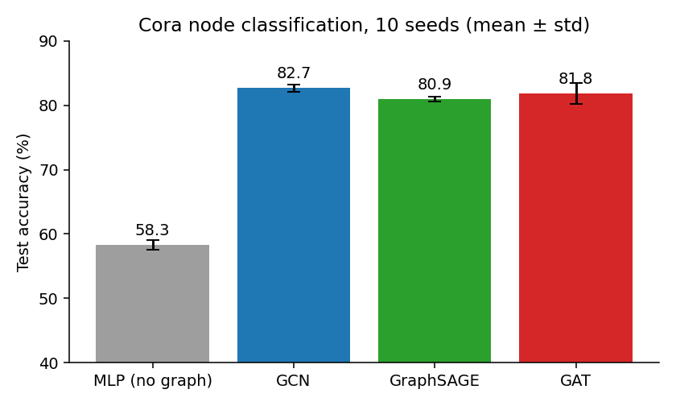
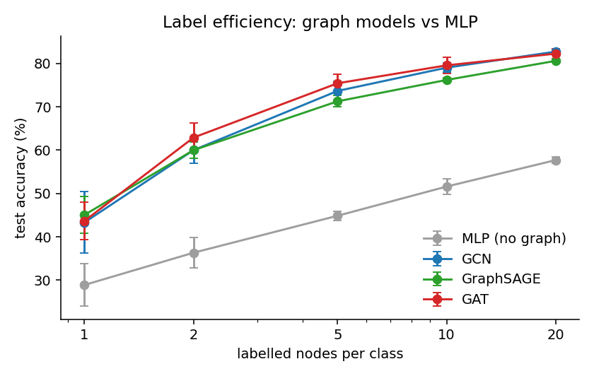
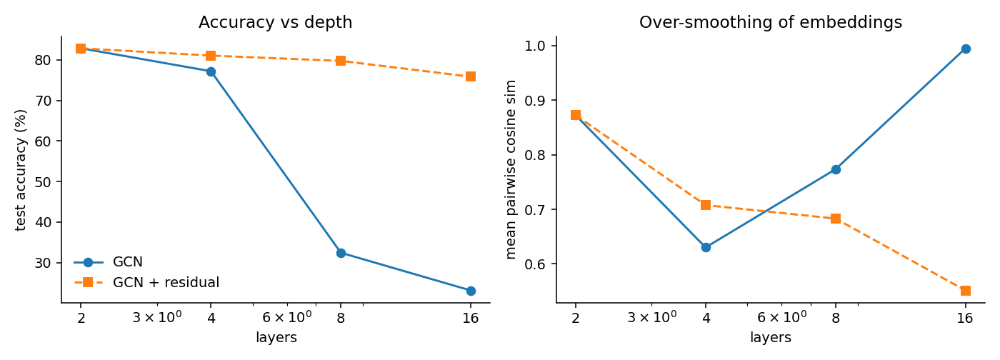
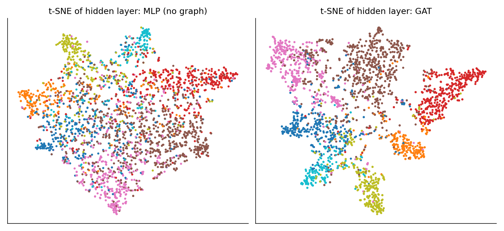
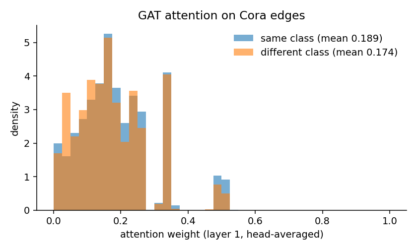
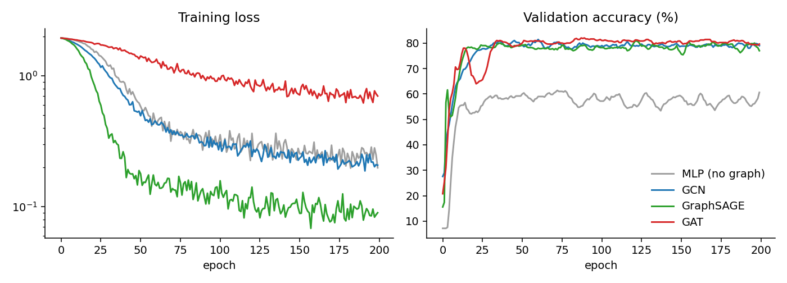

# gnn-from-scratch

**GCN, GraphSAGE and GAT in ~200 lines of plain PyTorch (no PyG, no DGL), plus reproducible experiments on Cora.**

All three layers are written on top of one `edge_index` tensor using `index_add_` and a scatter-softmax, so the message passing is explicit and easy to read.



## Results (Cora, public Planetoid split, 10 seeds)

| Model | Test accuracy | Paper | Time / run (CPU) |
|---|---|---|---|
| MLP (ignores edges) | 58.3 ± 0.7 | ~57-59 | 2.6 s |
| GCN (Kipf & Welling, 2017) | **82.7 ± 0.6** | 81.5 | 3.0 s |
| GraphSAGE-mean (Hamilton et al., 2017) | 80.9 ± 0.4 | n/a on Cora | 6.7 s |
| GAT (Veličković et al., 2018) | 81.8 ± 1.6 | 83.0 ± 0.7 | 4.2 s |

GCN reproduces the paper. GAT lands about 1 point below its reported number. The original used 100-epoch patience and more training epochs, while this repo caps training at 200 epochs with patience 50 to keep the full suite under 10 minutes.

## Analyses

### 1. Graph structure matters most when labels are scarce


| Labels per class | MLP | GCN | GraphSAGE | GAT |
|---|---|---|---|---|
| 1 | 28.9 | 43.3 | 45.1 | 43.7 |
| 2 | 36.3 | 60.0 | 60.0 | 62.9 |
| 5 | 44.9 | 73.7 | 71.3 | 75.4 |
| 20 | 57.7 | 82.7 | 80.6 | 82.3 |

With 5 labels per class (35 labelled nodes in total), a GNN already beats an MLP trained on 4× as many labels. Cora's edge homophily is 0.81, so neighbours are a strong source of labels.

### 2. Over-smoothing, and how residuals fix it


| Layers | GCN acc | GCN cos-sim | GCN + residual acc | GCN + residual cos-sim |
|---|---|---|---|---|
| 2 | 82.9 | 0.87 | 82.9 | 0.87 |
| 4 | 77.2 | 0.63 | 81.0 | 0.71 |
| 8 | 32.5 | 0.77 | 79.7 | 0.68 |
| 16 | **23.1** | **0.995** | 75.8 | 0.55 |

A 16-layer plain GCN collapses: the mean pairwise cosine similarity of its node embeddings reaches 0.995, so every node looks the same. Skip connections keep the embeddings distinct (0.55) and hold 76% accuracy. The cos-sim curve is not monotonic between 2 and 8 layers, because accuracy (and therefore training) is already breaking down there. It's a coarse diagnostic, not a precise measure.

### 3. What the hidden layer learns


### 4. Does GAT attention prefer same-class neighbours?


Only slightly: the mean first-layer attention on same-class edges is 0.189 versus 0.174 on cross-class edges. On a homophilous graph like Cora, attention ends up close to uniform. This matches the observation (e.g. Brody et al., 2022, *GATv2*) that GAT's attention is often nearly static.

### 5. Training dynamics


## Run it

```bash
pip install -r requirements.txt
python experiments.py          # ~10 min on a laptop CPU; writes results/ and figures/
```

`gnn.py` holds the data loader, the three layers and the models. `experiments.py` holds the experiments and plots.

## References
- T. Kipf, M. Welling. *Semi-Supervised Classification with Graph Convolutional Networks.* ICLR 2017.
- W. Hamilton, R. Ying, J. Leskovec. *Inductive Representation Learning on Large Graphs.* NeurIPS 2017.
- P. Veličković et al. *Graph Attention Networks.* ICLR 2018.
- Z. Yang, W. Cohen, R. Salakhutdinov. *Revisiting Semi-Supervised Learning with Graph Embeddings.* ICML 2016 (Planetoid splits; data in `data/` from [kimiyoung/planetoid](https://github.com/kimiyoung/planetoid)).
